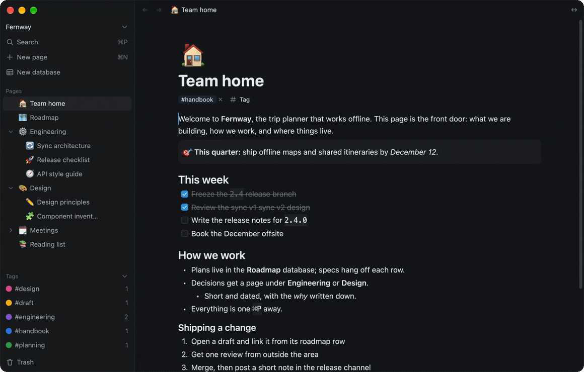

<p align="center">
  <picture>
    <source media="(prefers-color-scheme: dark)" srcset="assets/brand/scroll-inverse.svg">
    
  </picture>
</p>

# Scroll

A fast, local-first document and database app for macOS, written in Rust with [GPUI](https://www.gpui.rs).

<p align="center">
  
</p>

Scroll is a Notion-like workspace: pages made of blocks, databases with table views, and tags. It works on its own with a local file and no account. Connect it to a Scroll server and the same workspace becomes a team workspace with live co-editing.

> **Status:** early development. The app, the server and live sync work, but nothing has been released yet and there are no pre-built downloads.

## Features

- **Block editor**: headings, lists, to-dos, quotes, callouts, syntax-highlighted code and Mermaid diagrams, with rich text, Markdown shortcuts and slash commands.
- **Databases**: table views with typed properties, filters and sorts, built to stay smooth at hundreds of thousands of rows.
- **Local-first**: every workspace is one SQLite file on your machine. Edits apply instantly and work offline.
- **Live collaboration**: page content is a CRDT ([Loro](https://loro.dev)), so two people can type in the same block and see each other's cursors.
- **Self-hostable**: the server is a single binary backed by Postgres, with a Dockerfile and Compose file included.
- **Works with AI tools**: an optional built-in [MCP](https://modelcontextprotocol.io) server lets assistants such as Claude read, search and edit your workspace. It is off by default and only listens on your own machine.
- **Yours to set up**: nineteen themes, including Catppuccin, Ayu, Kanagawa and Tokyo Night, and every shortcut can be changed.
- **Search and command palette**: full-text search over titles, text and tags, and every command reachable from the keyboard.

## Getting started

You need macOS and a recent [Rust toolchain](https://rustup.rs) (edition 2024).

```sh
git clone https://github.com/TomByte/scroll.git
cd scroll
cargo run --release -p scroll-app
```

The app opens a local workspace on first run. No server or sign-in is needed.

## Running a server

A server is only needed for shared workspaces. With Docker, from the repository root:

```sh
printf 'POSTGRES_PASSWORD=%s\nDOMAIN=%s\n' "$(openssl rand -hex 24)" scroll.example.com > crates/scroll-server/.env
docker compose -f crates/scroll-server/docker-compose.yml --profile tls up -d --build
docker compose -f crates/scroll-server/docker-compose.yml exec scroll-server scroll-server create-invite
```

The last command prints a one-time invite code. In the app, add the server by its address and sign up with that code. See the [server README](crates/scroll-server/README.md) for settings, running without Docker, and Google sign-in.

## Project layout

One Cargo workspace, seven crates:

| Crate | What it holds |
|---|---|
| `scroll-core` | Records, validation, the SQLite store, page documents, search |
| `scroll-api` | Everything on the wire: HTTP types and the WebSocket protocol |
| `scroll-ui` | The GPUI component kit and theme |
| `scroll-table` | The database table view |
| `scroll-sync` | The client sync engine and account calls |
| `scroll-server` | The server |
| `scroll-app` | The desktop app |

[docs/architecture.md](docs/architecture.md) explains the design decisions, the data model and how sync works.

## Development

```sh
cargo test --workspace                       # server and sync tests need a local Postgres, see the server README
cargo run -p scroll-ui --example gallery     # every UI component, in light and dark
```
